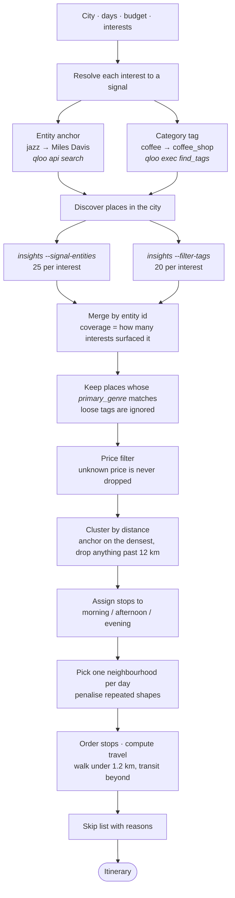
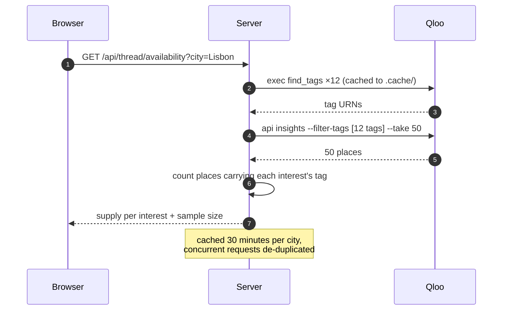

# Thread

**One thread through a city.** Tell it where you are going, how long for, and what you actually care
about. It returns a day-by-day route — one neighbourhood a day, stops ordered so you can walk them —
plus the obvious places it skipped and why.

Every place comes from the Qloo taste graph. Built for the Qloo Agentic Hackathon.

---

## The problem with every other list

Ask an LLM "I'm in Tokyo, I like indie rock, coffee and vintage" and you get a list of twelve good
places. It is not wrong. It is also the same list everyone gets, with no sense of what fits *you*, what
is open when you get there, or what you should skip.

Thread makes three different bets:

| A list gives you | Thread gives you |
|---|---|
| Twelve places | Three days, each in one neighbourhood |
| Any order | Ordered by time of day, with walk times between stops |
| Everything worth seeing | What to skip, and the reason |
| A vibe | How many of your interests each place actually covers |

## Inputs

- **City** — 110 curated cities across five continents, searchable, plus free text. Qloo resolves
  plain names correctly (`Paris` → Paris, France, not Texas; `Cambridge` → the UK one).
- **Days** — any number from 1 to 30, typed or picked from a preset
- **Budget** — `Budget` / `Mid` / `Any`, with a generic banknote mark and no currency symbol. Qloo
  normalises `price_range.currency` to USD for every city, so a `$`/`€`/`¥` glyph would be wrong
  everywhere. `price_level` itself is a local-market tier, which is what a traveller wants.
- **Interests** — twelve, and they adapt to the city (see below).

## How it decides



Three details that matter:

**The window assignment is exhaustive, not greedy.** If the best record shop takes the afternoon, a
second shop that also only opens in the afternoon is locked out — unless the first one moves to the
evening. A greedy pass gets this wrong; with three windows it is cheap to search.

**Long trips revisit neighbourhoods.** A city has fewer walkable clusters than a two-week trip has
days, so the planner works from whatever venues are still unused and penalises a district it just
used. It also tries packing three stops a day first, and only thins the days out if the requested
number cannot otherwise be filled — a two-week request should not quietly become ten days. If the
city genuinely runs out, the plan is short and the UI says so rather than padding it.

**Skipped places are the honest part.** They are the highest-scoring venues that did not make the
route, each with the reason: in a neighbourhood that is not on your route, or the slot went to a
better fit.

## Filters that adapt to the city

The interest list is not hand-curated per city. It is measured, once per city, and cached.



`--filter-tags` is an OR (verified: coffee + middle-eastern returned twelve coffee shops while
middle-eastern alone returned one), and it works without a taste signal, so this costs **one call per
city**.

What it measures, in practice:

| city | sampled | strongest |
|---|---|---|
| Lisbon | 50 | wine 27 · coffee 24 · art 16 · books 15 · ramen 11 |
| Lagos | 16 | books 9 · art 8 · coffee 7 |
| Reykjavik | 9 | coffee 6 · wine 4 |

The UI shows the count on each interest and collapses the ones with zero supply into
*"3 not found in Lisbon"*. Below 15 sampled places it does not group at all — a city that yielded four
places tells you nothing about what is missing there.

## Budget, and the trap in missing price data

Most places in a city like Lagos carry no `price_level` at all (3 of 20 in one sample). Treating
unknown as mid-range would silently delete them the moment you pick `Budget`. So unknown price is
**always allowed**, and the count is reported:

> Price data. 3 places had no price listed and were not filtered by budget.

`Any` never filters. A filtered-out place can never appear in the skip list claiming it was "over
budget", because nothing over budget reaches that stage.

## Setup

```bash
git clone https://github.com/pennywise-01/thread-qloo.git
cd thread-qloo
npm ci

npm install --global @qloo/qloo-harness
qloo setup --qloo            # event credential
qloo setup --status          # expect "Qloo data: ready"

cp .env.example .env         # base URL is pre-set; add QLOO_API_KEY or rely on the harness
npm run build
npm start                    # http://localhost:8787
```

Development: `npm run dev` (client :5173, API :8787).

The key stays on the server. It is never sent to the browser and no `VITE_` variable reads it.
`QLOO_BASE_URL` and `QLOO_TRUSTED_BASE_URL` already point at `https://hackathon.api.qloo.com` in
`.env.example`.

`npm run qloo:doctor` prints the raw harness responses the adapter parses, which is the first thing to
run if the shapes ever change.

## Verify without a browser

```bash
npm run smoke          # six itineraries against a fixed fixture, no credential needed
npm run cities:check   # probes every city, writes reports/city-coverage.json
```

`smoke` checks day counts, that no venue repeats, that no day has two stops in the same time window,
and that every travel leg is plausible. It includes a two-week request and a deliberately impossible
one-month request, which must come back short rather than padded.

`cities:check` is the pruning tool: it probes every city in `shared/cities.ts` and flags any that come
back thin (fewer than 10 places sampled, or fewer than 3 interests with any supply). Run it after
editing the city list.

The sweep drove the current list. Of the original 120 candidates, **89 were healthy** (mean sample 36),
21 were thin, and 10 returned **zero** places from Qloo — Copenhagen, Edinburgh, Shanghai, Chengdu,
Alexandria, Addis Ababa, Johannesburg, Riyadh, Perth and Nadi. Those ten were removed rather than
shipped as options that fail.

| city | sampled | strongest interests |
|---|---|---|
| Dublin | 36 | 11 of 12 |
| Oslo | 30 | 8 of 12 |
| Lisbon | 50 | wine 27 · coffee 24 · art 16 |
| Reykjavik | 9 | coffee 6 · wine 4 |
| Marrakech | 4 | coffee 3 · art 2 |

## What it found

Real places, real coordinates, real neighbourhoods:

```
3 days in Tokyo · jazz + coffee + vinyl
signals: Miles Davis · Blue Note · 3 calls

DAY 1  Setagaya · Sakurashinmachi 2   NEIGHBOR                 2 of 3
DAY 2  Shinjuku · Enoki cho           Can Color Cafe           2 of 3
                                      Rock Bar Mother          1 of 3   +15m train
DAY 3  Minato · Akasaka 3             J-WAVE                   1 of 3
                                      クローフィッシュ赤坂        2 of 3   +12m train
```

One call per interest, run in parallel. A three-interest plan takes about 11 seconds cold and is
instant afterwards (results cached 10 minutes per city). The UI shows the resolved signals and the
call count.

## What the data forced

- **Wards are not days.** Grouping by ward produced a "day in Setagaya" with a 58-minute walk
  between stops. Places are clustered by distance instead, and anything past 1.2 km is reported as
  transit rather than a walk.
- **Metro leakage.** A Lisbon search returns Belém, Cascais and Cabo da Roca. Clusters are anchored
  on the densest one and anything past 12 km is dropped, as are single-venue clusters.
- **Hotels, lodges and airports.** Qloo's place graph is Google-Places-derived, so they surface in
  almost any query. Filtered out.
- **Tags are not categories.** A place record carries ~100 loose audience tags, so "any tag contains
  book" matches a theatre. Qloo's `primary_genre` is the authoritative category and is what both the
  relevance filter and the venue label use.
- **Artist anchors only work for some interests.** "Haruki Murakami" returned churches and museums,
  not bookshops; "Radiohead" returned museums. Those interests now use a place-category tag
  (`urn:tag:category:place:book_store`), and `find_tags` results are filtered to prefer
  `urn:tag:{category,genre}:place` over product and setting tags — `specialty_coffee` returned
  literally zero places, `category:place:coffee_shop` returns every café.
- **Long tails.** A 4% match is noise. Anything under 20 is dropped unless that leaves too little to
  build a day from.
- **Losing the best place.** The district maths could skip a 100% match because its neighbourhood
  scored badly. The single best place in the city always anchors a day.
- **Attribution.** One merged call returns better places but loses which interest surfaced them.
  Each interest gets its own call so "2 of 3" is true.

## Event constraints, handled

- **Key never in a browser.** All Qloo calls are server-side. No `VITE_` variables.
- **No personal data.** Requests carry entity and tag identifiers, never names. `server/qloo/sanitize.ts`
  caps payloads at 40 options / 25 signals and refuses to dispatch a payload containing person-shaped
  fields.
- **No serverless.** Long-running Node server, per the kit's deployment guidance.
- **Small requests.** Responses cached 10 minutes for plans, 30 minutes for city probes.

## Layout

```
shared/cities.ts         110 cities + resolveCity (id, name, or free text)
shared/thread.ts         types, interests, budgets
server/thread/engine.ts  scoring, window assignment, district choice, routing
server/thread/discover.ts signals, category tags, relevance and price rules
server/thread/probe.ts   one-call city availability probe
server/qloo/tags.ts      interest → tag URN, disk-cached
server/qloo/             QlooPort + exec adapter + privacy guard
server/index.ts          Express API, serves the built client
src/                     React client
scripts/smoke.ts         itinerary invariants
scripts/cities-check.ts  coverage sweep over the city list
scripts/qloo-doctor.mjs  harness diagnostic
```

## Known limits

- **Compact cities repeat a neighbourhood.** Lisbon collapses into one walkable cluster, so a 3-day
  plan shows the same district three times. It is accurate — it just reads repetitively.
- **The probe is an estimate.** 50 places is a sample, not a census, and a city that yields 9 places
  cannot confidently report what is missing. Below 15 the UI stops grouping.
- **Interest → signal is a judgement call.** Only jazz, techno, art and vinyl use an artist anchor
  (Miles Davis, Aphex Twin, Yayoi Kusama, Blue Note Records) — entities work there because a jazz bar
  is genuinely what a jazz fan goes to. The other eight use place-category tags, because artist
  anchors for them returned landmarks instead of venues.
- **No opening hours.** Time windows are inferred from Qloo's time-of-day tags, not verified.
- **Clusters can strand a great place.** If the 96%-match venue is alone in a suburb it is dropped
  rather than made into a one-stop day. The skip list says so.
- **First plan is slow.** About 11 seconds cold; each Qloo call is a separate CLI process.
- **Clustering is greedy** and order-dependent when scores tie.
